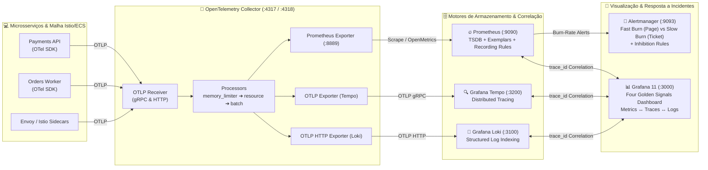

<div align="center">

# 📊 Acelera DevOps — Full-Stack Cloud-Native Observability Reference Architecture

[](https://opentelemetry.io/)
[](https://prometheus.io/)
[](https://grafana.com/)
[](https://grafana.com/oss/)
[](https://github.com/Acelera-DevOps/observability-stack/actions)

**Arquitetura de referência Production-Grade para Observabilidade Full-Stack (Métricas, Logs e Traces Distribuídos) baseada em OpenTelemetry, Prometheus, Grafana, Loki, Tempo e Alertmanager.**

Desenvolvido por **[Erik Tonon](https://github.com/eriktonon)** — *Head of Platform Engineering & GenAI @ IBM Consulting | Acelera DevOps*.

</div>

---

## 🎯 Visão Geral & Filosofia Build-to-Manage (BTM)

Na engenharia de confiabilidade moderna (**SRE**), monitorar uso de CPU isoladamente não evita indisponibilidade. Precisamos de **Observabilidade correlacionada ponta a ponta**, onde um pico de latência **P99** ou queima acelerada de **Error Budget** em um gráfico do Prometheus nos leva, em **1 clique via Exemplars (`trace_id`)**, exatamente ao *span* lento no **Grafana Tempo** e às linhas de log estruturadas no **Grafana Loki**.

Esta stack implementa de ponta a ponta:
1. **Vendor-Neutral Telemetry Pipeline (`OpenTelemetry Collector`)**: Ponto único de ingestão OTLP (`gRPC :4317` e `HTTP :4318`) com proteção contra OOM (`memory_limiter`), enriquecimento semântico (`resource`) e compressão em lotes (`batch`).
2. **Correlação Nativa dos 3 Pilares (`Metrics ↔ Traces ↔ Logs`)**: Provisionamento declarativo do Grafana (`datasources.yaml`) conectando *Prometheus Exemplars* ao *Tempo*, e *Tempo Spans* diretamente às queries LogQL do *Loki*.
3. **Google SRE Multi-Window, Multi-Burn-Rate Alerts**: Regras de gravação e alerta (`prometheus/alert.rules.yml`) calibradas para um **SLO de 99.9%** (*Fast Burn 14.4x Page* e *Slow Burn 6x Ticket*) + os **Quatro Sinais de Ouro (Four Golden Signals)**.

---

## 🗺️ Arquitetura do Pipeline de Telemetria



---

## 📐 Engenharia de SRE: Four Golden Signals & Error Budget Burn Rate

### 1. Os Quatro Sinais de Ouro (*Google SRE Book*)

O dashboard pré-provisionado (`grafana/dashboards/sre-golden-signals.json`) e as regras em `prometheus/alert.rules.yml` monitoram continuamente:

| Sinal de Ouro | Métrica / Recording Rule | Alerta Associado |
| :--- | :--- | :--- |
| **1. Latency (Latência)** | `job:http_request_duration_seconds:p95_5m` & `:p99_5m` | `GoldenSignalHighTailLatencyP99` (`P99 > 500ms` por `5m`) |
| **2. Traffic (Tráfego)** | `job:http_requests_total:rate5m` & `otelcol_receiver_accepted_spans` | `GoldenSignalTelemetryPipelineDown` (`up == 0` por `1m`) |
| **3. Errors (Erros)** | `job:http_requests_errors:rate5m` (proporção HTTP `5xx`) | `GoldenSignalHighHttp5xxRate` (`5xx > 5%` por `3m`) |
| **4. Saturation (Saturação)** | `otelcol_exporter_queue_size / otelcol_exporter_queue_capacity` | `GoldenSignalOtelCollectorQueueSaturation` (`> 80%` por `5m`) |

---

### 2. Alertas Multi-Window, Multi-Burn-Rate (*Google SRE Workbook*)

Para um **SLO de Disponibilidade de `99.9%`** em uma janela de **30 dias** ($720\text{ horas}$), o **Error Budget** total permitido é de $1 - 0.999 = 0.001$ ($0.1\%$, equivalente a **43,2 minutos** no mês).

A **Taxa de Queima (*Burn Rate*)** mede a velocidade relativa de consumo desse orçamento:
- $\text{Burn Rate} = 1\times$: Consome exatamente $100\%$ do orçamento em 30 dias.
- $\text{Burn Rate} = 14.4\times$: Consome **$2\%$ do orçamento mensal em apenas 1 hora** (esgotamento total em 50 horas).
- $\text{Burn Rate} = 6.0\times$: Consome **$5\%$ do orçamento mensal em 6 horas** (esgotamento total em 5 dias).

Para evitar falsos positivos sem perder velocidade de detecção quando o incidente termina, combinamos uma **janela longa** (tendência) e uma **janela curta** ($1/12$ da longa, garantindo que o erro ainda está ativo agora):

$$\text{Fast Burn (Page / Critical)} \iff \text{ErrorRatio}_{1\text{h}} > 14.4 \times (1 - \text{SLO}) \;\land\; \text{ErrorRatio}_{5\text{m}} > 14.4 \times (1 - \text{SLO})$$

$$\text{Slow Burn (Ticket / Warning)} \iff \text{ErrorRatio}_{6\text{h}} > 6.0 \times (1 - \text{SLO}) \;\land\; \text{ErrorRatio}_{30\text{m}} > 6.0 \times (1 - \text{SLO})$$

Além disso, o `alertmanager/alertmanager.yml` possui uma **regra de inibição (`inhibit_rules`)**: se o alerta crítico `burn_type="fast"` estiver disparando para um serviço, o alerta `burn_type="slow"` é automaticamente silenciado para evitar fadiga de alertas no plantonista.

---

## 🚀 Quick Start (`make up`)

### Pré-requisitos
- Docker Engine `24.0+` e Docker Compose `v2+`

### 1. Subir a Stack Completa

```bash
make up
# ou: docker compose up -d
```

### 2. Acessar as Interfaces Web

| Serviço | URL Local | Credenciais / Finalidade |
| :--- | :--- | :--- |
| **Grafana 11** | `http://localhost:3000` | Usuário: `admin` / Senha: `acelera-sre-admin` (Dashboard **SRE Four Golden Signals** já provisionado!) |
| **Prometheus** | `http://localhost:9090` | Explorador PromQL, Targets (`/targets`) e Status das Regras SRE (`/rules`) |
| **Alertmanager** | `http://localhost:9093` | Roteamento de incidentes (`critical` vs `warning`), silenciamentos e inibições |
| **OTel Collector** | `localhost:4317` (gRPC) / `localhost:4318` (HTTP) | Endpoint OTLP para envio de métricas, traces e logs de suas aplicações |
| **Grafana Tempo** | `http://localhost:3200` | Backend de Distributed Tracing consultado via TraceQL no Grafana |
| **Grafana Loki** | `http://localhost:3100` | Backend de agregação de logs estruturados consultado via LogQL no Grafana |

### 3. Validar Configuração e Regras SRE

```bash
make validate
```

---

## 📂 Estrutura do Repositório

```text
observability-stack/
├── .github/workflows/ci.yml                        # Pipeline CI validando YAML, JSON, Docker Compose e promtool
├── alertmanager/
│   └── alertmanager.yml                            # Roteamento por severidade + Inibição Fast Burn -> Slow Burn
├── grafana/
│   ├── dashboards/
│   │   └── sre-golden-signals.json                 # Dashboard SRE (Latency, Traffic, Errors, Saturation)
│   └── provisioning/
│       ├── dashboards/dashboards.yaml              # Auto-load de dashboards em /var/lib/grafana/dashboards
│       └── datasources/datasources.yaml            # Correlação Prometheus Exemplars <-> Tempo <-> Loki
├── loki/
│   └── loki-config.yaml                            # Loki 3.x TSDB schema v13 + Structured Metadata para OTLP
├── otel-collector/
│   └── otel-collector-config.yaml                  # Pipelines OTLP (metrics -> Prom, traces -> Tempo, logs -> Loki)
├── prometheus/
│   ├── alert.rules.yml                             # Recording Rules + Multi-Window Burn-Rate Alerts + Golden Signals
│   └── prometheus.yml                              # Scrape configs e integração com Alertmanager
├── tempo/
│   └── tempo.yaml                                  # Receptor OTLP de traces e armazenamento local de blocos
├── docker-compose.yml                              # Orquestração declarativa dos 6 serviços da stack
├── Makefile                                        # Automação de operação (up, down, ps, logs, validate, clean)
└── README.md                                       # Documentação arquitetural e guia SRE
```

---

## 📄 Licença

Distribuído sob a licença **MIT**. Veja [`LICENSE`](./LICENSE) para mais detalhes.
